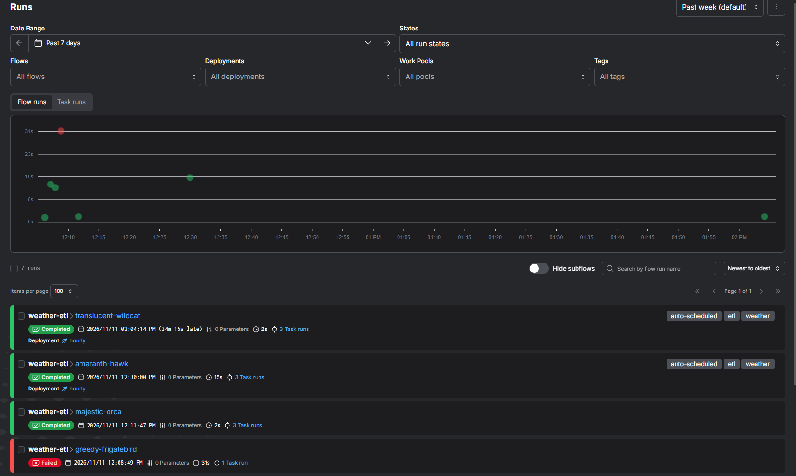
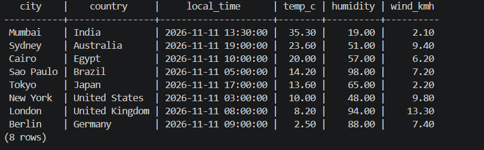
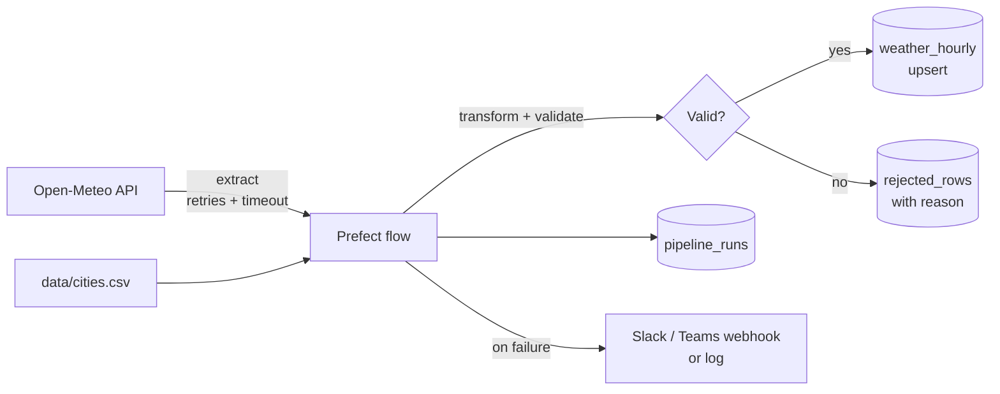
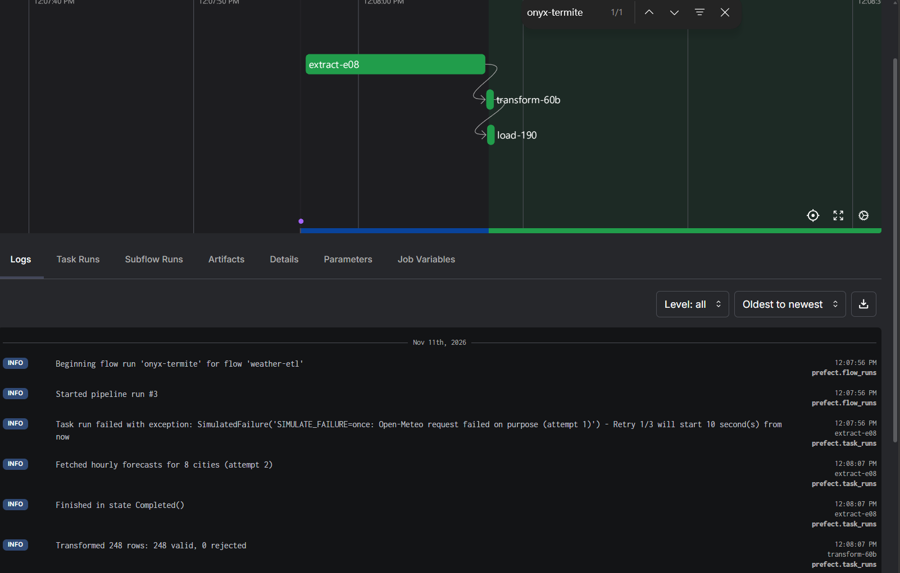

# Weather ETL Pipeline Demo

A scheduled Python pipeline that pulls hourly weather for eight cities from a public API, validates it, and loads it into PostgreSQL, with retries, duplicate-safe loads and failure alerts.



## What it does

- Pulls hourly weather from the free [Open-Meteo API](https://open-meteo.com/) (no API key) and joins it with a CSV of city metadata.
- Runs every hour on a Prefect schedule, with separate extract, transform and load tasks, each with retries and timeouts.
- Loads idempotently: rows are upserted on `(city, hour)`, so re-running the same hour never creates duplicates, and unchanged rows are not rewritten.
- Checks data quality (missing or out-of-range values, bad timestamps, duplicates) and stores bad rows in a `rejected_rows` table with the reason.
- Records every run in a `pipeline_runs` table and sends an alert to Slack or Microsoft Teams when a run fails. Without a webhook, alerts go to the log.

## Tech stack

Python 3.11, Prefect 3, httpx, SQLAlchemy 2, psycopg 3, PostgreSQL 16, Docker Compose, pytest.

## Quick start

You need [Docker Desktop](https://www.docker.com/products/docker-desktop/) (or Docker Engine with Compose v2.24+).

```bash
git clone https://github.com/JahedaParveen/etl-pipeline-demo.git
cd etl-pipeline-demo
cp .env.example .env        # PowerShell: Copy-Item .env.example .env
docker compose up --build
```

The first start downloads the images and takes a few minutes. After that:

| What | Where |
|---|---|
| Prefect UI (runs, logs, schedule) | http://localhost:4200 |
| PostgreSQL | `localhost:5433`, database `weather`, user and password from `.env` |

The pipeline runs once on startup, so data is in Postgres within a minute. After that it runs at the top of every hour.

**Run it now, on demand:**

```bash
# Through the Prefect deployment (shows up in the UI like a scheduled run)
docker compose exec pipeline prefect deployment run weather-etl/hourly

# Or directly, without the scheduler
docker compose exec pipeline python -m pipeline.run_once
```

**Look at the data:**

```bash
docker compose exec postgres psql -U etl -d weather -c "SELECT * FROM latest_city_weather;"
docker compose exec postgres psql -U etl -d weather -f /sql/reports.sql
```



**Stop everything:** `docker compose down` (add `-v` to also delete the database).

## How it works



1. **Extract** sends a single request to Open-Meteo for all cities in `data/cities.csv`. If it fails, Prefect retries it (3 times by default, 10 seconds apart).
2. **Transform** turns the API's column-based response into one row per city per hour, drops future (forecast) hours, and runs the data quality checks in [`pipeline/transform.py`](pipeline/transform.py).
3. **Load** writes everything in one database transaction: city metadata, weather rows (`INSERT ... ON CONFLICT DO UPDATE`, only when values changed) and rejected rows.
4. Every run is recorded in `pipeline_runs` with row counts (inserted, updated, unchanged, rejected), status and error message. If any step fails after its retries, the run is marked as failed and an alert is sent.

Two reporting views are created automatically: `daily_city_weather` (average, min and max temperature per city per local day) and `latest_city_weather`. More example queries are in [`sql/reports.sql`](sql/reports.sql).

**Database tables**

| Table | Contents |
|---|---|
| `cities` | City metadata from the CSV (country, coordinates, time zone, population) |
| `weather_hourly` | One row per city per hour. Primary key `(city_id, observed_at)` |
| `rejected_rows` | Rows that failed validation, with the reason and the original values as JSON |
| `pipeline_runs` | One row per run: start and end time, row counts, status, error |

### Demo: retries and alerts

Set `SIMULATE_FAILURE` in `.env` and restart the worker with `docker compose up -d pipeline`:

- `SIMULATE_FAILURE=once` makes the first extract attempt fail. Prefect retries it and the run succeeds. You can see the retry in the Prefect UI.
- `SIMULATE_FAILURE=always` makes every attempt fail. The run is marked as failed in `pipeline_runs` and an alert is sent.



To send alerts to Slack or Teams, paste an incoming webhook URL into `ALERT_WEBHOOK_URL` and set `ALERT_FORMAT` to `slack` or `teams`.

## Configuration

All settings are optional and have working defaults.

| Variable | Default | Description |
|---|---|---|
| `POSTGRES_USER` / `POSTGRES_PASSWORD` / `POSTGRES_DB` | `etl` / `etl` / `weather` | Database credentials, used by Compose and the pipeline |
| `POSTGRES_HOST_PORT` | `5433` | Port Postgres is published on, on your machine |
| `PREFECT_HOST_PORT` | `4200` | Port of the Prefect UI on your machine |
| `SCHEDULE_CRON` | `0 * * * *` | When the pipeline runs (cron syntax, UTC) |
| `RUN_ON_STARTUP` | `true` | Run once as soon as the worker starts |
| `PAST_DAYS` | `1` | How many past days of hourly data to request (0 to 92) |
| `EXTRACT_RETRIES` | `3` | Retries for the API call |
| `EXTRACT_RETRY_DELAY_SECONDS` | `10` | Wait between retries |
| `HTTP_TIMEOUT_SECONDS` | `20` | Timeout for the API request |
| `SIMULATE_FAILURE` | `none` | `none`, `once` or `always` (see above) |
| `ALERT_WEBHOOK_URL` | empty | Slack or Teams incoming webhook. Empty means alerts go to the log |
| `ALERT_FORMAT` | `slack` | `slack` (plain text) or `teams` (Adaptive Card) |
| `CITIES_FILE` | `data/cities.csv` | Change the list of cities by editing this file |

## Running tests

The tests cover the transform, validation, config and alert logic. They use JSON fixtures, so no network or database is needed.

```bash
# Inside Docker
docker compose run --rm --no-deps pipeline pytest -v

# Or locally with Python 3.11+
pip install -r requirements-dev.txt
pytest -v
```

## License

MIT. See [LICENSE](LICENSE).
